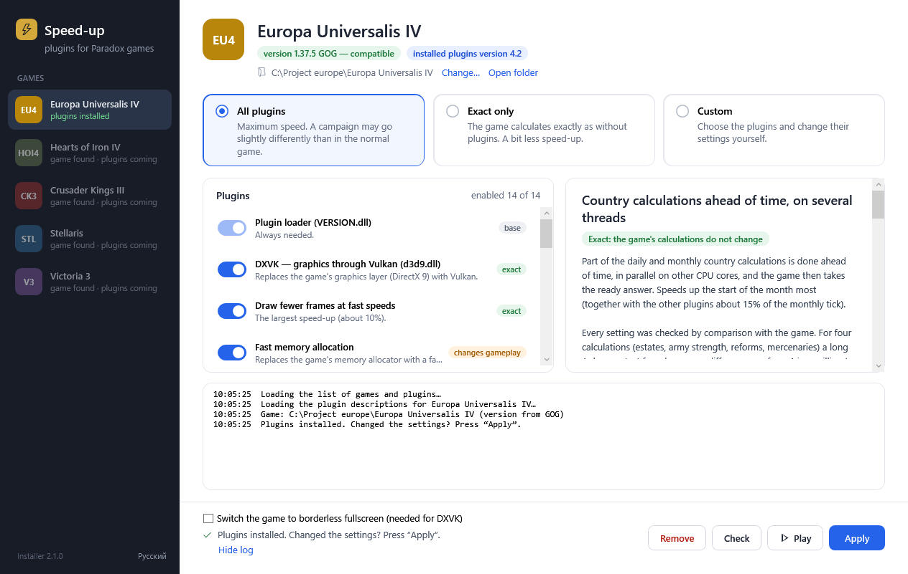

# Paradox games speed-up — installer

[Русская версия](README.ru.md)

`release/Uskorenie_Paradox.exe` is a single file of about 140 KB (WPF). It needs only .NET Framework 4.8, which Windows 10/11 already have. The interface is in English and Russian: the installer follows the Windows display language, and the switch at the bottom left changes it.

## What it does

- Shows every game from the catalogue. Each game has its own plugin set; a game without plugins yet is marked "coming".
- Finds each game by itself: in Steam (registry, `libraryfolders.vdf`, `appmanifest_<appid>.acf`) and in GOG (GOG Galaxy and offline installers: the `GOG.com\Games` registry key, the uninstall list, the default folders). The folder can also be chosen by hand; the choice is remembered.
- Checks the game version by the SHA-256 of the exe (Steam and GOG builds of EU4 1.37.5).
- Downloads the plugin descriptions and the archive, and verifies the checksums.
- Three modes: "All plugins", "Exact only", "Custom".
- Shows a description and the settings of every plugin.
- Writes the ini files, keeping comments and the user's settings on update.
- Removes plugins that were turned off. Keeps a foreign `VERSION.dll`/`d3d9.dll` and puts it back on removal.
- The "Check" button reads the plugin logs after the game has run.

## Files

| File | What it is |
|---|---|
| `catalog_src.json` | The list of games: id, name, Steam appid, exe path, process name, colour, status (`available` or `planned`). |
| `games/<id>/manifest_src.json` | The plugins of one game: files, ini, descriptions, settings, values for "Exact only", accepted exe hashes and their builds (`exe_builds`), builds a plugin works on (`builds`). Texts in English are in `*_en` fields, and a choice's third element is its English label. |
| `tools/make_release.py` | Builds `release/<id>_plugins.zip`, `release/<id>_manifest.json` (with checksums) and `release/catalog.json`. |
| `tools/build.py` | Builds the exe with the .NET Framework compiler (`src/Launcher.cs` + the embedded `src/MainWindow.xaml`). |

## Releasing plugins

1. Update `version` and the descriptions (Russian and `*_en`) in `games/<id>/manifest_src.json`.
2. Build the release files from the folder that is copied into the game:
   `python tools/make_release.py eu4 "..\eu4_package\launcher_v4_2"`
3. Upload all `release/*.json` files and `release/*_plugins.zip` to one GitHub Release of the `paradox-speedup` repository.
   The installer always takes them from `releases/latest/download/…`, so there is no need to hand out a new exe.

## Adding a game

1. In `catalog_src.json` set `"status": "available"` and `"manifest": "<id>_manifest.json"` for the game.
2. Create `games/<id>/manifest_src.json` following the EU4 one.
3. Run `make_release.py <id> <folder>`.

## Where things are

The installer reads the catalogue from the releases of the plugin repository: <https://github.com/Ostapcev/paradox-speedup/releases> (the address is `Config.DefaultSource` in `src/Launcher.cs`). The ready exe is in the [releases of this repository](https://github.com/Ostapcev/paradox-speedup-launcher/releases). The plugin code is at <https://github.com/Ostapcev/paradox-speedup>.

## Command line

| Option | What it does |
|---|---|
| `--source <url or folder>` | Another catalogue source, for example the local `release` folder. |
| `--game <id>` | Which game to open. |
| `--dir <folder>` | The folder of that game. |
| `--lang en\|ru` | Interface language (otherwise the saved choice or the Windows language). |
| `--ui-culture <name>` | For testing: act as if the Windows display language were this one (for example `en-US`). |
| `--auto all\|exact\|uninstall\|check\|shot[:plugin[:log]]` | Do one action without the user and write `launcher_auto.log` next to the exe. |

## Licence

MIT, see [LICENSE](LICENSE). The plugins the installer hands out come with their own licences (Bellows, Hamweard, EU4 Unicode Patch, DXVK).

This project is not affiliated with Paradox Interactive.
