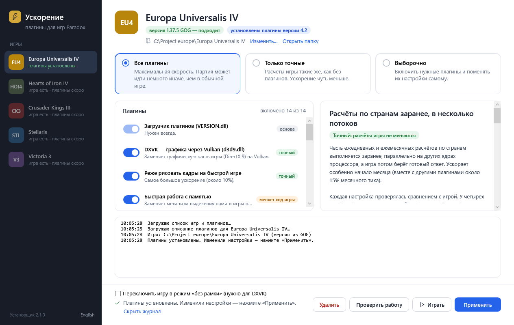

# Ускорение игр Paradox — установщик

[English version](README.md)

`release/Uskorenie_Paradox.exe` — один файл, ~140 КБ (WPF). Нужен только .NET Framework 4.8, он есть в Windows 10/11. Интерфейс на русском и английском: язык берётся из Windows, переключатель — внизу слева.

## Что делает

- Показывает все игры из каталога. У каждой игры свой набор плагинов; если плагинов пока нет, игра помечена «скоро».
- Сам находит каждую игру: в Steam (реестр, `libraryfolders.vdf`, `appmanifest_<appid>.acf`) и в GOG (GOG Galaxy и офлайн-установщики: ключ реестра `GOG.com\Games`, список установленных программ, стандартные папки). Папку можно указать вручную, выбор запоминается.
- Проверяет версию игры по SHA-256 exe (Steam- и GOG-сборки EU4 1.37.5).
- Скачивает описание плагинов и архив, сверяет контрольные суммы.
- Три режима: «Все плагины», «Только точные», «Выборочно».
- Для каждого плагина показывает описание и его настройки.
- Записывает ini, сохраняя комментарии и настройки пользователя при обновлении.
- Убирает отключённые плагины. Чужой `VERSION.dll`/`d3d9.dll` сохраняет и возвращает при удалении.
- Кнопка «Проверить работу» читает журналы плагинов после запуска игры.

## Как устроены файлы

| Файл | Что это |
|---|---|
| `catalog_src.json` | Список игр: id, название, Steam appid, путь к exe, имя процесса, цвет, статус (`available` или `planned`). |
| `games/<id>/manifest_src.json` | Плагины одной игры: файлы, ini, описания, настройки, значения для «Только точные», допустимые хэши exe и их сборки (`exe_builds`), сборки, где работает плагин (`builds`). Английские тексты — в полях `*_en`, третий элемент варианта настройки — его английская подпись. |
| `tools/make_release.py` | Собирает `release/<id>_plugins.zip`, `release/<id>_manifest.json` (с контрольными суммами) и `release/catalog.json`. |
| `tools/build.py` | Собирает exe компилятором .NET Framework (`src/Launcher.cs` + вшитый `src/MainWindow.xaml`). |

## Как выпустить плагины

1. Обновите `version` и описания (русские и `*_en`) в `games/<id>/manifest_src.json`.
2. Соберите файлы релиза из папки, которая копируется в игру:
   `python tools/make_release.py eu4 "..\eu4_package\launcher_v4_2"`
3. Загрузите в один GitHub Release репозитория `paradox-speedup` все файлы `release/*.json` и `release/*_plugins.zip`.
   Установщик всегда берёт их из `releases/latest/download/…`, поэтому раздавать новый exe не нужно.

## Как добавить новую игру

1. В `catalog_src.json` у игры поставьте `"status": "available"` и `"manifest": "<id>_manifest.json"`.
2. Создайте `games/<id>/manifest_src.json` по образцу EU4.
3. Выполните `make_release.py <id> <папка>`.

## Где лежат файлы

Установщик читает каталог из релизов репозитория плагинов: <https://github.com/Ostapcev/paradox-speedup/releases> (адрес — `Config.DefaultSource` в `src/Launcher.cs`). Готовый exe — в [релизах этого репозитория](https://github.com/Ostapcev/paradox-speedup-launcher/releases). Код плагинов — <https://github.com/Ostapcev/paradox-speedup>.

## Параметры командной строки

| Параметр | Что делает |
|---|---|
| `--source <url или папка>` | Другой источник каталога; например, локальная папка `release`. |
| `--game <id>` | Какую игру открыть. |
| `--dir <папка>` | Папка этой игры. |
| `--lang en\|ru` | Язык интерфейса (иначе сохранённый выбор или язык Windows). |
| `--auto all\|exact\|uninstall\|check\|shot[:плагин[:log]]` | Сделать одно действие без участия пользователя и записать `launcher_auto.log` рядом с exe. |

## Лицензия

MIT, см. [LICENSE](LICENSE). Плагины, которые раздаёт установщик, идут вместе со своими лицензиями (Bellows, Hamweard, EU4 Unicode Patch, DXVK).

Проект не связан с Paradox Interactive.
